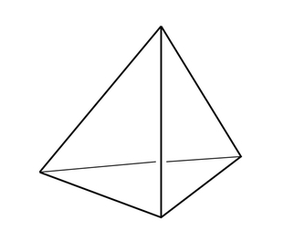

.. dsa-templates documentation master file, created by
   sphinx-quickstart on Wed Jun 19 13:16:13 2024.
   You can adapt this file completely to your liking, but it should at least
   contain the root `toctree` directive.

Welcome to DSA Templates!
=========================================
Collection of data structures and algos implementations in Python 3 and Rust

.. note::
   You can see code of all functions on this site by clicking on `[source]` as usual in tech docs.
   Maybe it is not the best approach to show implementations of algos and data structures and I should add more explicit code snippets.
   Hope this website will be useful for your journey in the world of algorithms and data structures.

.. toctree::
   :maxdepth: 2
   :caption: Contents:

   stack
   queue
   all_subsets
   binary_search
   binary_tree
   binary_search_tree
   graph
   trie
   dynamic_programming
   backtracking
   union_find
   minimum_spanning_tree
   fenwick_tree
   segment_tree
   sparse_table
   sorted_list
   interval_tree
   suffix_automaton
   rolling_hash
   bit_manipulation
   mo_algorithm
   heavy_light_decomposition
   centroid_decomposition
   bfs
   dfs
   dijkstra
   topological_sort
   multiset
   one_line
   math
   rust_crates

Indices and tables
==================

* :ref:`genindex`
* :ref:`modindex`
* :ref:`search`
